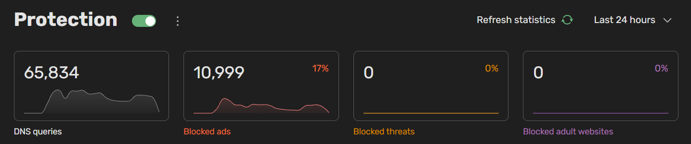

# HomeLab

Self-hosted DNS ad-blocking and media streaming on a repurposed Dell OptiPlex, with media stored on a Synology NAS.

Tools: Docker, Git/GitHub, and Claude Code as an AI assistant for drafting configs and docs. Every change was reviewed and verified on the live system.

Skills demonstrated: Linux (Ubuntu Server), Docker Compose, DNS (AdGuard Home, DNS over HTTPS), DHCP reservations, NFS, RAID (Synology SHR), SSH key management, Bash scripting, Git/GitHub, troubleshooting and documentation.

## Hardware

| Role | Device | Details |
|---|---|---|
| Docker host (`jaramilloserver`) | Dell OptiPlex 7010 | i5-3570, 8 GB RAM, 120 GB SSD, Ubuntu Server 26.04, USB Wi-Fi |
| NAS | Synology DS214se | 2 × 3 TB SHR, NFS export `/volume1/media` (read-only) |
| Router | eero | DHCP; custom DNS → `192.168.4.46` |

## Network

Subnet `192.168.4.0/22`.

```
            Internet
               │
       ┌───────┴────────┐
       │ eero           │ 192.168.4.1
       │ DNS → .4.46    │
       └───────┬────────┘
               │  LAN 192.168.4.0/22
     ┌─────────┴───────────────────┐
     │                             │
┌────┴──────────────────┐   ┌──────┴─────────────┐
│ jaramilloserver       │   │ Synology DS214se   │
│ 192.168.4.46 (Wi-Fi)  │   │ 192.168.4.10       │
│  ├─ AdGuard  :53/8080 │   │  /volume1/media    │
│  └─ Jellyfin :8096    │◄──┤  (NFS, SHR mirror) │
│ /mnt/media (NFS, ro)  │   └────────────────────┘
└───────────────────────┘
```

## Services

| Service | Ports | Purpose |
|---|---|---|
| [AdGuard Home](https://github.com/AdguardTeam/AdGuardHome) | 53 (DNS), 8080 (admin) | House-wide DNS and ad/tracker blocking |
| [Jellyfin](https://jellyfin.org/) | 8096, 7359/udp | Media server, VAAPI hardware transcoding (H.264 only) |

Both run in Docker with host networking ([`docker-compose.yml`](docker-compose.yml)). Reserved ports are in the [port plan](docs/01-hardware-and-planning.md#port-plan).

AdGuard's last 24 hours (2026-11-23): **65,834 DNS queries from 32 devices, 10,999 blocked (17%)**, 85 ms average processing time ([details](docs/05-adguard-home.md#verification)).



> **AdGuard is the DNS for the whole house.** Don't restart or recreate it casually; see [Updating](docs/03-docker.md#updating).

Check the whole stack (read-only) with `./health-check.sh` ([details](docs/03-docker.md#health-check)).

## Docs

1. [Hardware and planning](docs/01-hardware-and-planning.md): devices, IPs, DHCP reservations, port plan
2. [Ubuntu install](docs/02-ubuntu-install.md): BIOS, Rufus, installer choices, SSH
3. [Docker](docs/03-docker.md): install, compose, volumes, updating, health check
4. [Synology NAS and NFS](docs/04-synology-nas-and-nfs.md): SHR pool, NFS export, read-only mount
5. [AdGuard Home](docs/05-adguard-home.md): port 53, blocklists, upstreams, eero DNS
6. [Jellyfin](docs/06-jellyfin.md): libraries, read-only settings, VAAPI
7. [Version control and tools](docs/07-version-control-and-tools.md): repo, `gh`, commit email, what's in git

- [Troubleshooting](docs/troubleshooting.md): every problem I've hit, with links to the fixes
- [Changelog](CHANGELOG.md)
