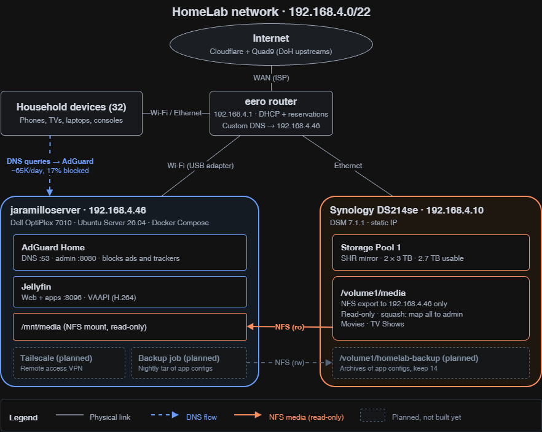

# 01 · Hardware and planning

## Goal

Run house-wide DNS ad-blocking and a media server on hardware I already owned, with the media itself on a NAS.

## What I built

I repurposed the Dell OptiPlex 7010 because I already had it. It's a stopgap: an HP ProDesk 600 G6 is planned as the future host (see [Next steps](#next-steps)).

| Role | Device | Details |
|---|---|---|
| Docker host (`jaramilloserver`) | Dell OptiPlex 7010 | Intel Core i5-3570 (4C/4T, 3.4 GHz, HD Graphics 2500), 8 GB RAM, SanDisk SSD Plus 120 GB (`SDSSDA120G`, 111.8 GiB usable), Legacy BIOS boot |
| Host OS | Ubuntu Server 26.04.1 LTS | Docker + Docker Compose ([03](03-docker.md)) |
| Network | Onboard Ethernet | Interface `eno1`, wired to the Deco. Until 2026-11-27: USB Wi-Fi adapter `wlx90de8000ec5a` |
| NAS | Synology DS214se | 2 × 3 TB, SHR (1-drive fault tolerance), `/volume1/media` over NFS ([04](04-synology-nas-and-nfs.md)) |
| Router | TP-Link Deco | DHCP for the LAN with reservations; DHCP Primary DNS points at the Docker host; IPv6 off. Replaced an eero on 2026-11-27 |

### Network

Subnet: `192.168.68.0/22`



| Device | IP | MAC | Notes |
|---|---|---|---|
| TP-Link Deco router | `192.168.68.1` | — | DHCP Server Primary DNS set to `192.168.68.81`; IPv6 off |
| Synology DS214se | `192.168.68.2` | `00:11:32:44:23:E4` | DHCP reservation in the Deco; NFS server |
| OptiPlex 7010 (`jaramilloserver`) | `192.168.68.81` | `34:17:eb:b9:2e:09` (`eno1`, wired) | DHCP reservation in the Deco; AdGuard Home + Jellyfin |

Before 2026-11-27 (eero, `192.168.4.0/22`): router `192.168.4.1`, Synology `192.168.4.10` (also set as static in DSM), server `192.168.4.46` over USB Wi-Fi (MAC `90:de:80:00:ec:5a`).

### Port plan

Both containers use `network_mode: host`, so they bind straight to the host's ports. That keeps DNS and Jellyfin's LAN discovery simple, but two services on the same port means one fails at start. Check this table before adding a service, and update it when ports change.

| Port | Assigned to | Status |
|---|---|---|
| 53 | AdGuard Home DNS | In use |
| 80, 443 | Nginx Proxy Manager | Reserved |
| 3000 | AdGuard Home first-run wizard | Setup only |
| 3001 | Uptime Kuma | Reserved |
| 3002 | Grafana | Reserved |
| 7359/udp | Jellyfin client discovery | In use |
| 8080 | AdGuard Home admin | In use |
| 8096 | Jellyfin | In use |

## Steps

1. Pick a host and a static address plan (table above).
2. In the Deco app, add DHCP address reservations: `jaramilloserver` → `192.168.68.81` (MAC `34:17:eb:b9:2e:09`, `eno1`), Synology → `192.168.68.2` (MAC `00:11:32:44:23:E4`). The server is the house DNS, so its address must never change. (On the eero, the reservations were `192.168.4.46` for the server's Wi-Fi MAC and `192.168.4.10` for the Synology.)
3. Reserve ports for planned services before installing anything ([port plan](#port-plan)).

## Verification

On the server, the Ethernet port's MAC and address should match the reservation:

```bash
ip -br link show eno1        # 34:17:eb:b9:2e:09
ip -br -4 addr show eno1     # 192.168.68.81/22
ip route show default        # default via 192.168.68.1 dev eno1
```

Checked 2026-11-27: all three match. Both reservations (`.81` and `.2`) are set in the Deco app.

## Problems and fixes

### High latency over USB Wi-Fi

Pings of around 220 ms over the USB Wi-Fi adapter (before the move to wired Ethernet; the IPs below are the old eero addresses).

- The ~220 ms was `ping google.com` run from the server on 2026-11-22, right after freeing port 53 for AdGuard.
- Retest from the server on 2026-11-23 was normal: router `192.168.4.1` avg 5 ms, NAS `192.168.4.10` avg 3 ms, `1.1.1.1` avg 54 ms (20–85 ms, high jitter). So the 220 ms was a one-time spike.

### No IP after the router swap (eno1 not in netplan)

After replacing the eero with the Deco on 2026-11-27 and plugging the server in with Ethernet, the server had no IP address. The installer had only configured the USB Wi-Fi adapter in netplan, so the onboard port `eno1` never requested a DHCP lease.

Fix (2026-11-27):

1. Added `/etc/netplan/60-ethernet.yaml` so `eno1` uses DHCP. The Deco reservation gives it `192.168.68.81`:
   ```yaml
   network:
     version: 2
     ethernets:
       eno1:
         dhcp4: true
   ```
2. In `/etc/netplan/00-installer-config.yaml`, set the Wi-Fi interface to `optional: true`, so boot doesn't wait for Wi-Fi. That file holds the Wi-Fi password, so it's never copied into the repo.
3. On the Synology, *Control Panel → Shared Folder → media → Edit → NFS Permissions*: changed the rule's IP from `192.168.4.46` to `192.168.68.81` ([04](04-synology-nas-and-nfs.md#on-the-synology-dsm)).
4. In `/etc/fstab`, changed the NAS IP from `192.168.4.10` to `192.168.68.2` (backup `/etc/fstab.bak-2026-11-27`) and remounted `/mnt/media`.

Check:

```bash
ip -br -4 addr show eno1          # 192.168.68.81/22
grep media /etc/fstab             # 192.168.68.2:/volume1/media /mnt/media nfs ro,_netdev 0 0
showmount -e 192.168.68.2         # /volume1/media exported to 192.168.68.81
findmnt -no OPTIONS /mnt/media    # starts with "ro,"
./health-check.sh
```

## What I learned

- Old hardware is good enough for a home server. An i5-3570 with 8 GB runs DNS and a media server easily; the limits show up in video transcoding, not everyday services.
- Planning IPs and ports up front saves trouble later. With host networking, two services can't share a port, so a port plan prevents conflicts before they happen.
- A DNS server needs a fixed address. If its IP changes, the whole house loses internet, so DHCP reservations aren't optional.

## Next steps

- [x] Wired Ethernet for reliability: done 2026-11-27 with the Deco (`eno1`, reservation updated).
- [ ] Move to an HP ProDesk 600 G6 (i5-10500, 16 GB) once it has an NVMe SSD.
- [ ] Add the reserved services: Nginx Proxy Manager, Uptime Kuma, Grafana.
