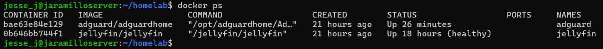
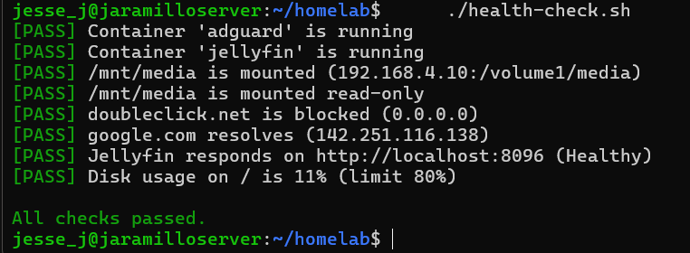

# 03 · Docker

## Goal

Run AdGuard Home and Jellyfin as containers from one `docker-compose.yml`, with pinned images, and have a read-only way to check the whole stack.

## What I built

- Docker Engine 29.10.0 and Docker Compose v5.8.0, installed with the `get.docker.com` script.
- `jesse_j` in the `docker` group, so no `sudo` for `docker` commands.
- [`docker-compose.yml`](../docker-compose.yml): both services with `network_mode: host` and `restart: unless-stopped`, images pinned to a version tag plus digest (AdGuard Home `v1.0.0`, Jellyfin `12.4`).
- [`health-check.sh`](../health-check.sh): a read-only health check ([below](#health-check)).

### Volumes

| Container | Host path | Container path | Notes |
|---|---|---|---|
| adguard | `./adguard/work` | `/opt/adguardhome/work` | Query logs, stats (git-ignored) |
| adguard | `./adguard/conf` | `/opt/adguardhome/conf` | Config incl. credentials (git-ignored) |
| jellyfin | `./jellyfin/config` | `/config` | Library DB, users (git-ignored) |
| jellyfin | `./jellyfin/cache` | `/cache` | Transcode/image cache (git-ignored) |
| jellyfin | `/mnt/media` | `/media` | NAS media, read-only (`:ro`) ([04](04-synology-nas-and-nfs.md)) |
| jellyfin | `/dev/dri` | `/dev/dri` | iGPU for VAAPI transcoding ([06](06-jellyfin.md)) |

### What's not in git

`adguard/` and `jellyfin/` hold runtime data, logs and password hashes. They're git-ignored along with `.env`, keys and certificates. Back them up separately and never commit them.

## Steps

1. Install Docker:
   ```bash
   curl -fsSL https://get.docker.com -o get-docker.sh
   sudo sh get-docker.sh
   ```
2. Let `jesse_j` use Docker without `sudo`, then log out and back in:
   ```bash
   sudo usermod -aG docker jesse_j
   ```
3. Test it:
   ```bash
   docker run --rm hello-world
   ```
4. Before starting the stack, mount the NAS ([04](04-synology-nas-and-nfs.md)) and free port 53 ([05](05-adguard-home.md#port-53-already-in-use-systemd-resolved)). Then:
   ```bash
   docker compose up -d
   ```

### Updating

> **AdGuard is the DNS for the whole house.** Recreating the `adguard` container takes DNS down for every device until it's back. Do it at a quiet time and have a fallback ready (e.g. temporarily switch the eero's DNS back to automatic).

The images are pinned by digest, so `docker compose pull` won't fetch anything new by itself. To update:

1. Change the tag and digest for the service in `docker-compose.yml`.
2. Update one service at a time, Jellyfin first:
   ```bash
   docker compose pull jellyfin && docker compose up -d jellyfin
   ```
3. Run `./health-check.sh`, then clean up with `docker image prune -f`.

## Verification

```bash
id -nG                     # includes docker
docker version --format '{{.Server.Version}}'
docker compose ps          # adguard and jellyfin both running
./health-check.sh
```





### Health check

`health-check.sh` is **read-only**. It never starts, stops or restarts anything.

| # | Check | Passes when |
|---|---|---|
| 1 | Containers | `adguard` and `jellyfin` are both `running` |
| 2 | NAS mount | `/mnt/media` is a mountpoint |
| 2b | NAS read-only | `/mnt/media` mount options include `ro` |
| 3 | Ad blocking | `doubleclick.net` is blocked (`0.0.0.0`, `NXDOMAIN`, `REFUSED`, or empty answer) |
| 4 | DNS resolution | `google.com` resolves to a real IP via AdGuard |
| 5 | Jellyfin | `GET /health` returns `Healthy` |
| 6 | Disk | Root filesystem usage is below 80% |

Each check prints `[PASS]` or `[FAIL]` (in colour when run in a terminal). The script exits `0` if everything passes and `1` if anything fails, so it can run from cron or a monitoring tool.

You can override the defaults with environment variables, e.g. `DISK_LIMIT=90 ./health-check.sh`:

| Variable | Default |
|---|---|
| `DNS_SERVER` | `192.168.4.46` |
| `MEDIA_MOUNT` | `/mnt/media` |
| `JELLYFIN_URL` | `http://localhost:8096` |
| `DISK_PATH` | `/` |
| `DISK_LIMIT` | `80` (percent) |

It needs `docker`, `dig` (`dnsutils`), `curl` and `findmnt`.

## Problems and fixes

### Health check didn't catch a read-write NAS mount

The health check only tested that `/mnt/media` was mounted, so it passed while the host had the share mounted read-write. Fixed by adding check 2b. The full story is in [04](04-synology-nas-and-nfs.md#docs-said-read-only-but-the-host-mount-was-read-write).

## What I learned

- Docker Compose turns a whole setup into one file that can be backed up, versioned and moved to new hardware.
- Host networking is simpler for DNS but gives up Docker's port isolation, so the server's firewall and router settings matter more.
- Pinning image versions prevents surprise upgrades. Updating one service at a time, then running a health check, is safer than updating everything at once.

## Next steps

- [ ] Run `health-check.sh` on a schedule (cron or Uptime Kuma) and alert on failure.
- [ ] Back up `adguard/` and `jellyfin/` (planned): nightly tar archives to the NAS export `/volume1/homelab-backup`, keeping the last 14. To be documented in `docs/08-backups.md` (not written yet). See also [04](04-synology-nas-and-nfs.md#second-nfs-export-not-documented).
