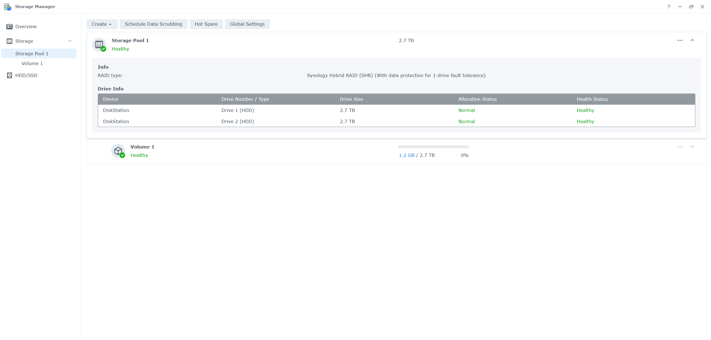
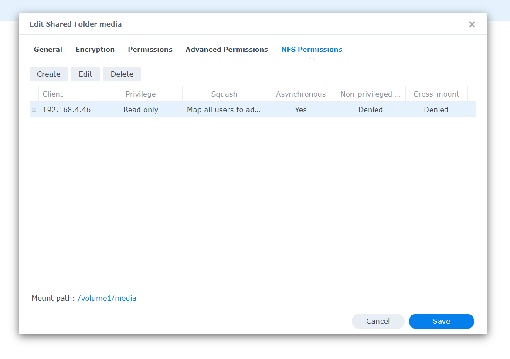

# 04 · Synology NAS and NFS

## Goal

Store media on the Synology DS214se with redundancy, and give the server read-only access over NFS, so Jellyfin (or anything else on the host) can never modify or delete it.

## What I built

- Storage pool: **SHR** with 1-drive fault tolerance on 2 × 3 TB drives (in effect a mirror).
- **Volume 1**, ext4 → `/volume1`.
- Shared folder `media`, exported over NFS to `192.168.4.46` only.
- Read-only at both levels:
  - **Host:** `/etc/fstab` mounts it at `/mnt/media` with `ro,_netdev`. The previous fstab is saved as `/etc/fstab.bak-2026-11-23`.
  - **Container:** Jellyfin gets it as `/mnt/media:/media:ro` ([`docker-compose.yml`](../docker-compose.yml)).

| Setting | Value |
|---|---|
| DSM version | 7.1.1-42962 Update 9 |
| IP | `192.168.4.10`, set manually (static) in DSM, matching the eero DHCP reservation |
| MAC | `00:11:32:44:23:E4` |

## Steps

### On the Synology (DSM)

1. *Storage Manager → Storage → Create → Create Storage Pool*: **SHR**, 1-drive fault tolerance, select both 3 TB drives. This **erases** the drives ([below](#no-storage-pool-old-pool-data-on-the-drives)).
2. Create **Volume 1** on that pool, file system **ext4**.
3. *Control Panel → File Services → NFS*: enable NFS.
4. *Control Panel → Shared Folder*: create `media`, then *Edit → NFS Permissions → Create*:

   | Field | Value |
   |---|---|
   | Hostname or IP | `192.168.4.46` |
   | Privilege | Read only |
   | Squash | Map all users to admin |
   | Asynchronous | Yes |
   | Allow connections from non-privileged ports | No (Denied) |
   | Allow users to access mounted subfolders (cross-mount) | No (Denied) |

   Confirmed in DSM on 2026-11-23.

### On the server

1. Add to `/etc/fstab`:
   ```
   192.168.4.10:/volume1/media /mnt/media nfs ro,_netdev 0 0
   ```
2. Mount it:
   ```bash
   sudo mkdir -p /mnt/media && sudo mount -a
   ```
   To switch an existing mount to read-only without unmounting: `sudo mount -o remount,ro /mnt/media`.

## Verification

```bash
showmount -e 192.168.4.10            # /volume1/media exported to 192.168.4.46
findmnt -no OPTIONS /mnt/media       # starts with "ro,"
touch /mnt/media/.rw-test            # should fail: Read-only file system
docker inspect -f '{{range .Mounts}}{{.Destination}} rw={{.RW}}{{"\n"}}{{end}}' jellyfin   # /media rw=false
./health-check.sh                    # checks 2 and 2b pass
```

Checked 2026-11-23: the live mount is `ro`, Jellyfin's `/media` is `rw=false`, and all health checks pass.





## Problems and fixes

### No storage pool; old pool data on the drives

You can't create a shared folder or an NFS export until there's a volume. DSM showed the drives still had storage pool data from earlier use.

Fix: I chose to erase the old pool data, then created a new SHR storage pool on both drives and Volume 1 on top of it.

### Docs said read-only but the host mount was read-write

CLAUDE.md and the README said the share was mounted `ro`, but on 2026-11-23 `findmnt` showed `rw`. `/etc/fstab` still had `defaults,_netdev`, and the backup the docs mentioned didn't exist. Jellyfin was still protected by its `:ro` bind, but anything else on the host could write to the NAS. The health check passed because it only checked that the share was mounted.

Fix (2026-11-23):

```bash
sudo cp -a /etc/fstab /etc/fstab.bak-2026-11-23
sudo sed -i '11s|nfs defaults,_netdev|nfs ro,_netdev|' /etc/fstab
sudo systemctl daemon-reload
```

The live mount was then read-only (`findmnt` shows `ro,`). The health check also got a new check (2b) that fails if the mount isn't `ro`.

### Second NFS export not documented

`showmount -e 192.168.4.10` also lists `/volume1/homelab-backup`, exported to `192.168.4.46`. It isn't mounted in `/etc/fstab`.

It was created for nightly backups of the server's `adguard/` and `jellyfin/` folders (tar archives, keeping the last 14). This is **planned, not set up yet**. The mount and backup job will be documented in `docs/08-backups.md` (not written yet).

## What I learned

- RAID is not a backup. SHR protects against a dead drive, not against deleted files or a failed NAS.
- NFS controls access by IP address instead of a username and password, so the permission rule on the NAS is the main security control.
- Read-only should be enforced at every layer. My docs said the share was read-only, but the host had it read-write. I only caught it by checking, so I added a health check for it.

## Next steps

- [x] Fill in the DSM version and confirm the NFS rule in DSM ([above](#on-the-synology-dsm)).
- [x] Decide what `/volume1/homelab-backup` is for: nightly backups ([above](#second-nfs-export-not-documented)).
- [ ] Off-NAS backup of the media: not set up yet. Planned later with an external USB drive and Hyper Backup. (SHR protects against a dead drive, not against deletion.)
