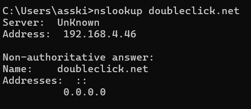
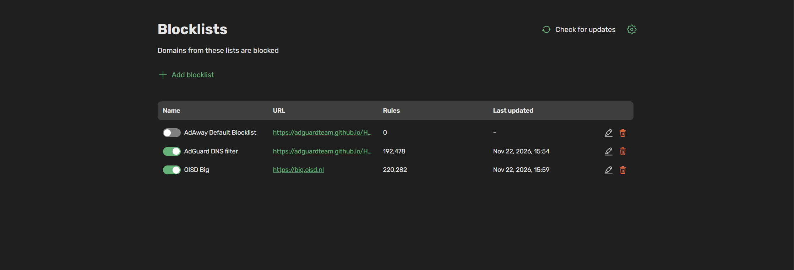
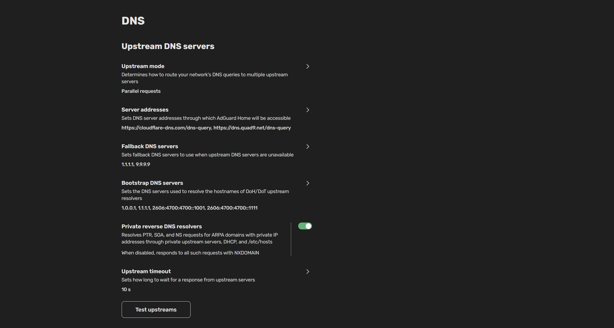
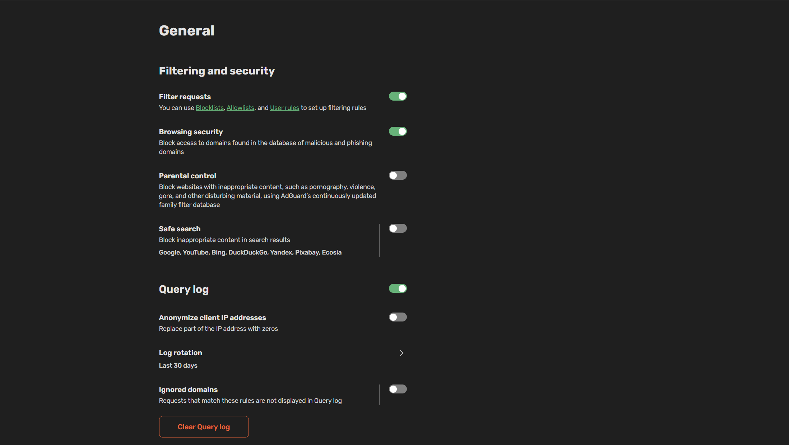

# 05 · AdGuard Home

## Goal

Block ads and trackers for every device in the house at the DNS level, by making the server the eero's DNS.

> **AdGuard is the DNS for the whole house.** If the `adguard` container stops or gets recreated, every device loses DNS. See CLAUDE.md Rule 1 and the update procedure in [03](03-docker.md#updating).

## What I built

- AdGuard Home `v1.0.0` in Docker, host networking ([`docker-compose.yml`](../docker-compose.yml)).
- DNS on port **53** (TCP/UDP). The admin UI is on **8080**, which keeps 80 free for Nginx Proxy Manager.
- The host's own resolver bypasses AdGuard and uses `1.1.1.1`, so the server can still resolve names (e.g. to pull images) when AdGuard is down.

| Setting | Value |
|---|---|
| Blocklists (enabled) | AdGuard DNS filter, OISD Big (`https://big.oisd.nl`) |
| Blocklists (disabled) | AdAway |
| Upstream DNS (DoH) | `https://cloudflare-dns.com/dns-query`, `https://dns.quad9.net/dns-query` |
| Upstream mode | Parallel requests |
| Fallback DNS | `1.1.1.1`, `9.9.9.9` |
| Bootstrap DNS | `1.0.0.1`, `1.1.1.1`, `2606:4700:4700::1001`, `2606:4700:4700::1111` |
| Private reverse DNS resolvers | Enabled |
| Upstream timeout | 10 s |

General settings:

| Setting | Value |
|---|---|
| Browsing security (malware/phishing) | Enabled. Replaces the eero Secure protection I turned off ([below](#eero-custom-dns-greyed-out)) |
| Parental control | Off |
| Safe search | Off |
| Query log rotation | 30 days (changed from 90, to limit disk use and privacy exposure) |

The admin login is a local username whose bcrypt password hash is stored in `AdGuardHome.yaml`. AdGuard has no email address or online account, so there's no "forgot password" option ([below](#forgot-the-admin-password-login-rate-limited)).

The settings above were not read from `adguard/conf`, which holds credentials and is never put into docs (CLAUDE.md Rule 3).

## Steps

1. Free port 53 on the host ([below](#port-53-already-in-use-systemd-resolved)).
2. `docker compose up -d adguard`.
3. Open `http://192.168.4.46:3000` for the first-run wizard. Set the admin UI to port **8080** and DNS to port **53**.
4. In the admin UI (`http://192.168.4.46:8080`):
   - *Filters → DNS blocklists*: enable AdGuard DNS filter, add OISD Big, disable AdAway.
   - *Settings → DNS settings*: set the upstreams, upstream mode, fallback, bootstrap, private reverse DNS and timeout from the table above.
   - *Settings → General settings*: enable browsing security, leave parental control and safe search off, set query log rotation to 30 days.
5. In the eero app, turn off **all eero Secure features** ([below](#eero-custom-dns-greyed-out)), then set **Custom DNS** to `192.168.4.46`.

## Verification

From a laptop on the LAN:

```
nslookup doubleclick.net
Server:  192.168.4.46
...
Address: 0.0.0.0
```

The answer should come from `192.168.4.46` and resolve to `0.0.0.0`, which means it's blocked.



From the server (also checked by health checks 3 and 4):

```bash
dig @192.168.4.46 doubleclick.net +short   # 0.0.0.0
dig @192.168.4.46 google.com +short        # a real IP
sudo ss -tulpn | grep ':53 '               # only AdGuard listening
```

Checked 2026-11-23: health checks 3 and 4 pass, and port 53 is held on `*:53` (TCP and UDP).

### Dashboard results (last 24 hours, 2026-11-23)

| Metric | Value |
|---|---|
| DNS queries | 64,219 |
| Blocked | 10,776 (16.8%) |
| Clients | 32 devices |
| Average processing time | 84 ms |

Top blocked domains included Roku telemetry (`scribe.logs.roku.com`) and ad/tracking domains.

### Settings screenshots







## Problems and fixes

### Port 53 already in use (systemd-resolved)

AdGuard failed to start with `bind: address already in use`, because Ubuntu's `systemd-resolved` runs a stub DNS listener on `127.0.0.53:53`.

Fix: turn off the stub listener and point the host's resolver at `1.1.1.1`:

```bash
sudo mkdir -p /etc/systemd/resolved.conf.d
sudo tee /etc/systemd/resolved.conf.d/adguard.conf >/dev/null <<'EOF'
[Resolve]
DNS=1.1.1.1
DNSStubListener=no
EOF
sudo ln -sf /run/systemd/resolve/resolv.conf /etc/resolv.conf
sudo systemctl restart systemd-resolved
docker compose up -d adguard
```

Checked 2026-11-23: the override file is in place and `/etc/resolv.conf` → `/run/systemd/resolve/resolv.conf`.

### eero Custom DNS greyed out

The Custom DNS option in the eero app couldn't be changed.

Fix: turn off **all eero Secure features** (eero Plus ad blocking and filtering use their own DNS). After that, Custom DNS can be set. AdGuard's browsing security now covers the malware/phishing protection eero Secure used to provide.

### Forgot the admin password; login rate-limited

I forgot the admin password, and repeated attempts hit AdGuard's login rate limit (HTTP 429, blocked for about 12 minutes). AdGuard has no email or account recovery: the login is a local username with a password hash in `AdGuardHome.yaml`.

Fix (2026-11-23):

1. Generated a new bcrypt hash **locally**, not with an online generator:
   ```bash
   htpasswd -B -C 10 -n <username>    # prints <username>:<hash>
   ```
2. Backed up `AdGuardHome.yaml`.
3. Stopped AdGuard. **This is a brief house-wide DNS outage** (CLAUDE.md Rule 1).
4. Replaced the user's `password:` hash in `AdGuardHome.yaml`.
5. Started AdGuard and confirmed with `./health-check.sh`.

The restart also clears the rate-limit lockout.

Never commit `AdGuardHome.yaml` or its backup. They live in `adguard/`, which is git-ignored (CLAUDE.md Rule 3).

## If the server is down

Every device loses DNS while AdGuard is down. To get the house back online:

1. In the eero app, go to **Settings → Network settings → DNS** and choose **ISP DNS (Default)**.
2. After the server is fixed, switch back to **Custom** DNS `192.168.4.46`.

## What I learned

- DNS filtering blocks by domain name, so it can't stop ads served from the same domain as the content, like YouTube ads.
- A lot of home network traffic is telemetry. Smart TVs and apps constantly report usage, and about 17% of my household's DNS queries were ads and trackers.
- Two services can't use the same port. `systemd-resolved` was holding port 53, so I had to disable its stub listener before AdGuard could run.
- Rate limiting works. Too many wrong passwords locked me out for 12 minutes, which is the same protection that stops brute-force attacks.
- When one device handles DNS for everyone, it's a single point of failure, so I documented a fallback (switching the eero back to ISP DNS).

## Next steps

- [x] Fill in the upstream mode (parallel requests).
- [x] A fallback DNS plan for when the server is down: switch the eero back to ISP DNS ([steps](#if-the-server-is-down)).
- [ ] Put the admin UI behind Nginx Proxy Manager (80/443) once it's set up.
